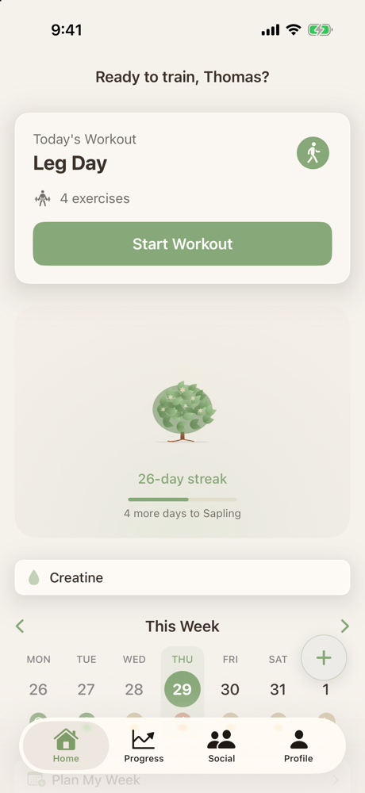
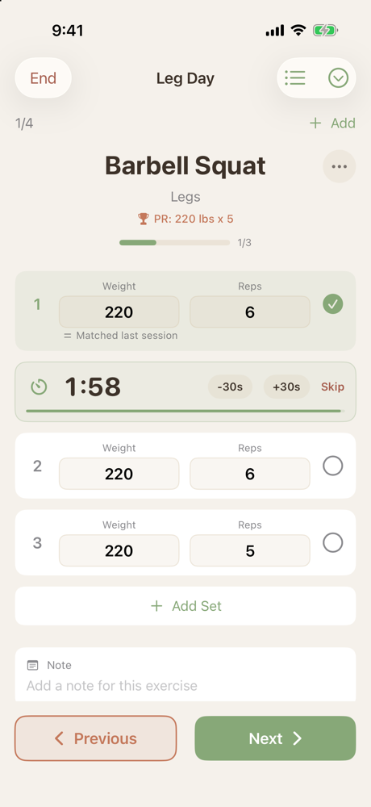
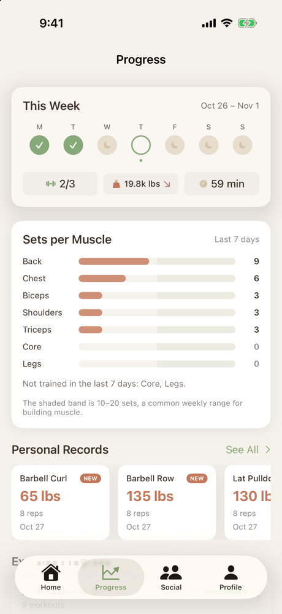
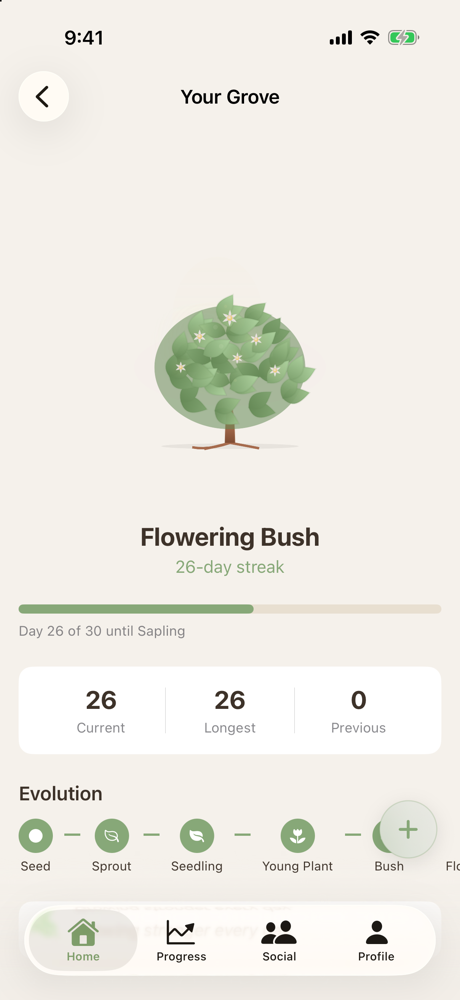
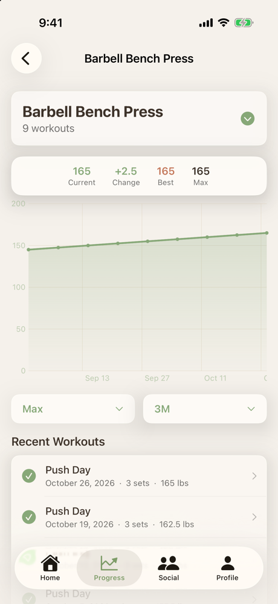
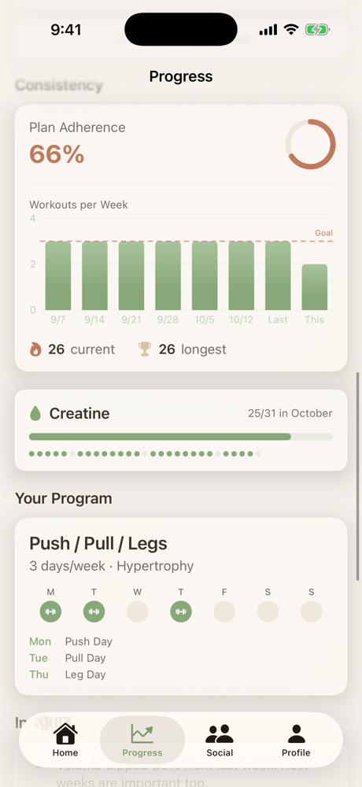
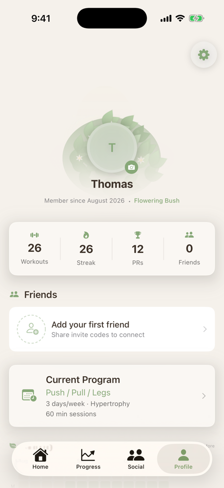
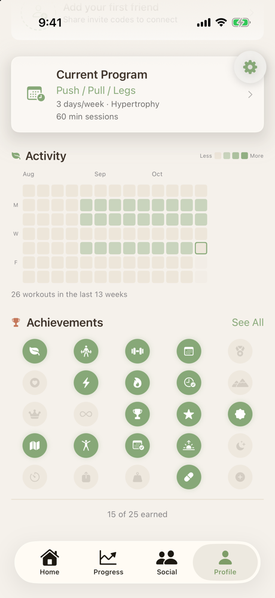
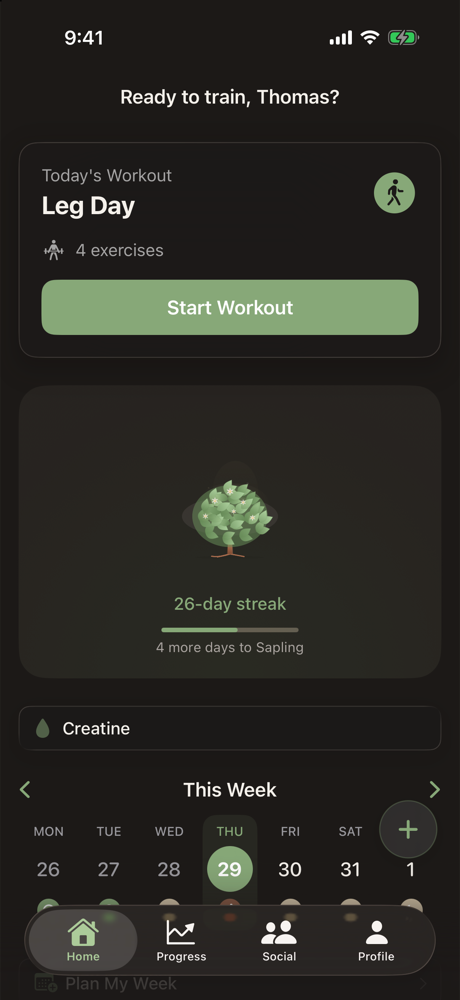

<p align="center">
  
</p>

<h1 align="center">Grove</h1>

<p align="center">
  <strong>A strength-training tracker where your consistency grows into a little tree.</strong><br/>
  Native iOS 26 · SwiftUI + Liquid Glass · Zero third-party dependencies
</p>

<p align="center">
  
  
  
  
</p>

<p align="center">
  
  &nbsp;
  
  &nbsp;
  
</p>

---

## What is Grove?

Grove is a workout tracker I built for a small crew of friends and family, roughly 5–10 people who lift and want something simple, good-looking, and native. No ads, no subscriptions, no account system beyond Sign in with Apple.

The idea is pretty simple: **show up, and your plant grows.** Every workout feeds a streak, and that streak turns into a plant that grows from a seed into a full grove tree over 100 days. Skip too long and it wilts. It's a small thing, but it makes it a lot easier to get to the gym on days you'd rather not.

Under the hood it's a full strength-training log: planned weeks, progressive overload nudges, PR detection, charts, Apple Watch data, and a friends feed that uses watering, seeds, and sunlight instead of likes.

> **Status:** Grove is in active use (v1.0, build 9). Strength training is the focus for now. Cardio and marathon training are on the roadmap.

---

## Features

### 🏋️ Workout logging that stays out of your way


- **One exercise at a time**, full screen, with big weight and rep fields and +/- steppers
- **Last-session hints** show what you did last time, with nudges to add weight or reps when you're ready
- **Plateau detection.** If your best set hasn't moved in 3 sessions, Grove suggests a lighter week at about 90% instead of pushing more weight
- **Rest timer** starts on its own when you complete a set. Adjust it ±30s, skip it, or set a default per exercise (compounds get 2:00, isolations 1:30)
- **Warmup sets** (long-press to toggle) that don't count toward your stats or PRs
- **Per-exercise notes**, plus skip, replace, or reorder mid-workout
- **Session resume.** Close the app mid-workout and pick up where you left off. Every set saves as you go
- **Repeat workouts** from the + menu or from any past workout
- **163 built-in exercises**, and you can add your own from any picker

<br clear="right"/>

### 🌱 Streaks that actually grow



Your streak is drawn as a hand-built Canvas plant with **10 stages**:

| Stage | Days | | Stage | Days |
|---|---|---|---|---|
| Seed | 0 | | Flowering Bush | 21 |
| Sprout | 1 | | Sapling | 30 |
| Seedling | 3 | | Young Tree | 45 |
| Young Plant | 7 | | Tree | 60 |
| Bush | 14 | | Grove Tree | 100 |

Streaks follow your plan. If you've set up a training week, you only lose the streak when a whole Mon–Sun week goes by with no workouts, so rest days won't cost you anything. Reaching a new stage after a workout plays a short moment that shows off the new plant.

<br clear="right"/>

### 📅 Planning your week

- **Smart Builder onboarding** picks your days, session length, split (Full Body, Upper/Lower, PPL, Bro, Arnold, or Custom), and rep range, then builds your templates for you
- **Weekly calendar strip** on Home with planned, completed, skipped, and rest days at a glance
- **Plans fill themselves in.** Grove keeps the current and next week populated from your preferred training days
- **Choose your training days** any time from Profile → Training Days

### 📈 Progress you can see

<p>
  
  &nbsp;
  
  &nbsp;
  
</p>

- **This Week** summary: workouts done, total volume (with trend), and average duration
- **Sets per Muscle** over the last 7 days, against a 10–20 set "building muscle" band, plus a callout for anything you haven't trained
- **Personal Records** based on your heaviest weight, with a NEW badge on fresh ones. Your first session sets the baseline quietly. Celebrations are saved for beating it
- **Per-exercise charts** built with Swift Charts, with 1M / 3M / 6M / All ranges
- **Consistency**: plan adherence, workouts per week vs. your goal, current and longest streak
- **Insights** that call out stale lifts ("no PR in 60 days, consider a deload") and week-over-week volume swings
- **Creatine tracking** (optional) with a daily check-in and monthly calendar

### 🏆 Profile, activity & achievements

<p>
  
  &nbsp;
  
</p>

- A profile hero that wraps your photo in your current plant stage
- A **13-week activity heatmap**
- **25 achievements** across milestones, streaks, PRs, variety, and habits ("Early Bird", "Volume King", "Supplement Streak", and more)

### 🤝 A friends feed with no likes

The social tab is built for a small, close group, not for followers. Friends connect with **invite codes**, and instead of likes and comments you can:

| Gesture | What it means |
|---|---|
| 💧 **Water** | The everyday "nice work." One per person per post |
| ☀️ **Sunlight** | Earned. You can only give it after finishing your own workout that day |
| 🌰 **Seeds** | A short message (picked from a list or written yourself, 60 characters) that sticks around as a sprout |

Over time those interactions build **Root Connections** between friends (Scattered → Growing → Intertwined → Deep Roots), which show up in a **Grove Network** view of your circle. You can also share a workout template as a `grove://` link so a friend can import it with one tap. You control exactly what gets shared: name, duration, exercises, weights, PRs, and program.

### ⌚ Apple Watch, widgets & notifications

- **HealthKit (read-only).** After a workout, Grove looks for an overlapping Apple Watch session and attaches heart rate (min/avg/max) and calories
- **Home Screen widgets:** Streak Plant, Today's Plan, and Weekly Progress, each in small, medium, and large
- **Notifications** that try not to nag: workout reminders, week-ahead summaries, streak-at-risk nudges, creatine reminders, friend activity, and quiet hours

### 🌗 Dark mode



The earthy palette works in both modes. Choose System, Light, or Dark in Settings.

---

## Design

Grove's look comes from soil, clay, and plants, with iOS 26 Liquid Glass used sparingly on floating chrome like the tab bar, toolbars, and FAB.

| | Name | Hex | Used for |
|---|---|---|---|
|  | Sage | `#87A878` | Primary: buttons, progress, highlights |
|  | Terracotta | `#C4785B` | Accents, PRs, completed states |
|  | Warm Sand | `#D4C4A8` | Cards, dividers |
|  | Charcoal | `#3D3229` | Text (light), backgrounds (dark) |
|  | Cream | `#F5F1EB` | Backgrounds (light) |
|  | Muted Rust | `#A65E4E` | Warnings, skipped exercises |

---

## Tech Stack

Everything is first-party Apple. There's no `Package.swift`, no CocoaPods, and nothing to install.

| Layer | Framework |
|---|---|
| UI | SwiftUI + iOS 26 Liquid Glass |
| Persistence | SwiftData (local-only on device) |
| Social backend | CloudKit public database (feed, friends, interactions, push) |
| Auth | Sign in with Apple (AuthenticationServices) |
| Health | HealthKit + HealthKitUI (read-only) |
| Charts | Swift Charts |
| Widgets | WidgetKit (shared via an App Group) |
| Notifications | UserNotifications + CloudKit subscriptions |
| Concurrency | Swift 6 strict concurrency |

### Architecture at a glance

```
Grove/
├── GroveApp.swift        # @main, ModelContainer, background tasks, push handling
├── Models/               # SwiftData @Model classes (User, Workout, ExerciseLog, SetLog, PersonalRecord, …)
├── Services/             # The brains: WorkoutSessionManager, SmartBuilderEngine, StreakManager,
│                         #   PRDetectionService, ProgressInsightsEngine, CloudKitSocialService, …
├── Views/                # Onboarding, Home, Workout, Progress, Social, Profile, Library
├── Components/           # GlassCard/Button, StreakPlant (Canvas renderer), FeedCard animations, CoachMarks
└── Data/                 # Exercise seeds + preview sample data
GroveWidgets/             # Streak Plant, Today's Plan, Weekly Progress widgets
docs/                     # Product spec, onboarding/smart-builder/widget plans
```

```
User ─┬─ workouts ──── Workout ─┬─ exercises ── ExerciseLog ── sets ── SetLog
      ├─ plans ─────── WorkoutPlan └─ templateUsed ── WorkoutTemplate
      ├─ personalRecords ── PersonalRecord ── exercise ── Exercise
      ├─ customExercises, creatineLogs, achievements
```

A few decisions worth knowing about:

- **Workout data never leaves your phone.** SwiftData runs with `cloudKitDatabase: .none`. CloudKit is used only for the social feed, and only for what you choose to share.
- **`WorkoutSessionManager`** (`@MainActor @Observable`) owns the whole workout lifecycle: building a session from a template, progression and deload hints, saving, PR detection, and the summary → streak-moment flow.
- **The plant is drawn, not imported.** `PlantCanvasRenderer` draws every stage with SwiftUI `Canvas`, and so do the feed card scenes and the Grove Network.

For the full picture, see [`docs/PRODUCT_SPEC.md`](docs/PRODUCT_SPEC.md).

---

## Getting Started

### Requirements

- **Xcode 26** or later
- **iOS 26** simulator or device (iPhone 17 Pro simulator works well)
- An Apple Developer account if you want Sign in with Apple, HealthKit, CloudKit, and push on a real device

### Run it

```bash
git clone https://github.com/thomaskahessay/Grove.git
```

```bash
open Grove/Grove.xcodeproj
```

Then pick the **Grove** scheme and an iOS 26 simulator, and hit **⌘R**.

> 💡 **Tip:** In Debug builds the sign-in screen has a **"Continue without Sign In"** button, so you can try the whole app in the simulator without an Apple ID. The Social tab also has debug-only **Add Test Friend** and **Remove Test Data** actions.

### Running on your own device

The project is set up for my team and identifiers. To run it under your account:

1. Change the **bundle identifier** for both the `Grove` and `GroveWidgetsExtension` targets
2. Set your **development team** under Signing & Capabilities
3. Update the **iCloud container** (`iCloud.icloud.thomaskahessay.Grove`) in the entitlements and in `CloudKitSocialService.swift`
4. Update the **App Group** (`group.com.thomaskahessay.Grove`) for the app and widget targets
5. Make sure these capabilities are on: Sign in with Apple, HealthKit, iCloud (CloudKit), Push Notifications, App Groups

---

## Roadmap

- [x] Strength logging, plans, streak plant, PRs, achievements
- [x] HealthKit, widgets, notifications
- [x] Social feed with water / sunlight / seeds and root connections
- [x] Plateau deloads, muscle volume, configurable rest timer
- [ ] Cardio tracking
- [ ] Marathon / running training plans
- [ ] Apple Watch companion app

---

## Contributing

Grove is a personal project for a small group of people, so I'm not really looking for outside PRs right now. That said, if you're one of the people using it and something's broken or bugging you, tell me. Issues and feature ideas are always welcome.

<p align="center">
  <sub>Built with SwiftUI and stubbornness 🌳</sub>
</p>
